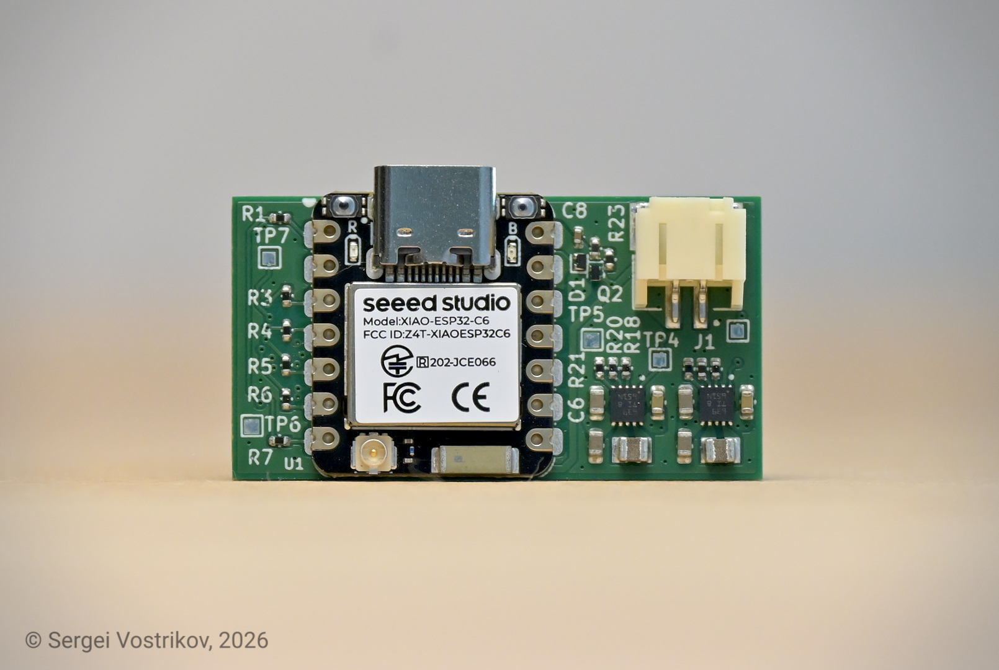
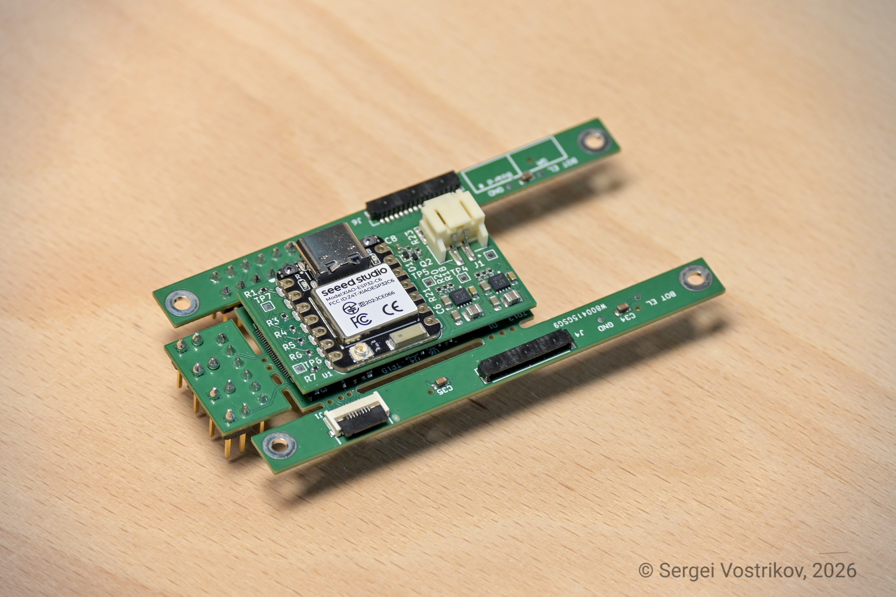

# WULPUS Pro Max
## Multi-mode Ultra-Low-Power Wearable Ultrasound Platform
> WULPUS Pro Max adopts the core analog front end of the original [WULPUS PRO design](https://github.com/pulp-bio/wulpus-pro), while extending its analog performance, firmware architecture, host connectivity, and software tooling. The project is independently developed and maintained by [Sergei Vostrikov](https://github.com/Sergio5714) and contributors.

<p align="center">
  
</p>

## Contents

- [Introduction](#introduction)
  - [Key capabilities](#key-capabilities)
  - [Hardware gallery](#hardware-gallery)
- [Quick start](#quick-start)
- [Documentation](#documentation)
- [Clone the repository](#clone-the-repository)
- [Repository structure](#repository-structure)
- [Citation](#citation)
- [Changelog](#changelog)
- [Authors](#authors)
- [License](#license)

# Introduction

WULPUS Pro Max is a modular, open-source wearable ultrasound platform for
research and development. It combines a flexible ultrasound acquisition front
end, dedicated USB and Wi-Fi host hardware, embedded firmware, and desktop and
Python software for configuration, streaming, visualization, and analysis.

The same hardware supports one-cable USB benchtop operation and portable
Wi-Fi operation from a battery or power bank. Firmware for both controllers can
be updated through the desktop application without an external programmer.

## Key capabilities

- 16 time-multiplexed channels with PZT and CMUT support
- Up to 30 V excitation from approximately 100 kHz to 10 MHz
- Up to 76 dB total receive gain with time-gain compensation
- Raw ultrasound streaming over USB CDC or Wi-Fi/TCP, with legacy BLE support
- Pulse repetition frequencies up to 500 Hz
- 40 x 20 mm acquisition PCB footprint

See the [full specifications](docs/full_specifications.md) for measured analog,
acquisition, power, imaging, and mechanical characteristics.

## Hardware gallery

<table>
  <tr>
    <td width="50%" align="center">
      
      <br/>
      WULPUS PRO Acquisition PCB (development version)
    </td>
    <td width="50%" align="center">
      
      <br/>
      WULPUS Pro Max WiFi host PCB
    </td>
  </tr>
  <tr>
    <td width="50%" align="center">
      
      <br/>
      Assembled WULPUS Pro Max system
    </td>
    <td width="50%" align="center">
      
      <br/>
      WULPUS PRO module with PolyCMUT transducer
    </td>
  </tr>
</table>

# Quick start

1. Obtain or manufacture the Acquisition PCB and WiFi host PCB using the
   released hardware files and the [hardware guide](hw/README.md).
2. Download the standalone desktop executable from
   [GitHub Releases](https://github.com/Sergio5714/wulpus-pro-max/releases) and
   run it directly; no installation is required. Developers can instead follow
   the [source setup instructions](sw/docs/dependency_installation.md).
3. Connect the WiFi host PCB to the Acquisition PCB and connect a data-capable
   USB-C cable to the host computer.
4. Follow the [firmware update guide](docs/firmware_update_guide.md) to install
   compatible ESP32 and MSP430 firmware packages.
5. Use the [desktop GUI guide](docs/desktop_gui_usage.md) to connect, configure
   an acquisition, and record data.

For battery-powered Wi-Fi operation and detailed power guidance, see the
[operating modes guide](docs/operating_modes.md).

# Documentation

The [WULPUS Pro Max documentation portal](docs/index.md) is the authoritative
source for user instructions:

- [Hardware overview and replication](docs/hardware_overview.md)
- [Host board options](docs/host_board_options.md)
- [USB and wireless operating modes](docs/operating_modes.md)
- [Desktop Application](docs/desktop_gui_usage.md)
- [Firmware updates](docs/firmware_update_guide.md)
- [Full system specifications](docs/full_specifications.md)

Developer and manufacturing documentation remains next to the corresponding
source files:

- [PCB designs and fabrication](hw/README.md)
- [ESP32 host firmware](fw/esp32/README.md)
- [MSP430 acquisition firmware](fw/msp430/README.md)
- [Legacy nRF52 BLE firmware](fw/nrf52/README.md)
- [Python software and notebooks](sw/README.md)

For background information about the original WULPUS platform, see the
[legacy WULPUS User Manual](https://github.com/Sergio5714/wulpus/blob/main/docs/wulpus_user_manual.pdf).

# Clone the repository

Clone the public repository without its private development submodule:

```bash
git clone https://github.com/Sergio5714/wulpus-pro-max.git
```

The private `hw/kicad_us_lib` development submodule is not required to use the
released fabrication files. See the
[hardware README](hw/README.md#internal-kicad-library) for details.

Authorized developers can initialize the private submodule after cloning:

```bash
git submodule update --init --recursive
```

# Repository structure

The repository is organized into four top-level folders. See the README files
inside them for component-level details.

- [`hw`](hw) — PCB design and fabrication files.
- [`fw`](fw) — embedded firmware source code.
- [`sw`](sw) — Python software, graphical interfaces, and notebooks.
- [`docs`](docs) — user documentation and images.

# Citation

Please cite our [arXiv preprint](https://arxiv.org/abs/2607.12137):

```bibtex
@article{vostrikov2026wulpuspro,
  title={WULPUS PRO: Multi-mode Ultra-Low-Power Wearable Ultrasound and Array Imaging with CMUT Support},
  author={Vostrikov, Sergei and Villani, Federico and Hirschi, Cedric and Lu, Jinhao and Welsch, Jonas and Angerer, Martin and Cretu, Edmond and Rohling, Robert and Cossettini, Andrea and Benini, Luca},
  journal={arXiv preprint arXiv:2607.12137},
  year={2026},
  url={https://arxiv.org/abs/2607.12137}
}
```

If you would like to cite this repository, please use:

```bibtex
@misc{wulpus_pro_repo_sergio5714_2026,
  title={WULPUS Pro Max: Multi-mode Ultra-Low-Power Wearable Ultrasound Platform (Independently Maintained)},
  author={Vostrikov, Sergei and Villani, Federico and Hirschi, Cedric and Cossettini, Andrea and Benini, Luca},
  year={2026},
  howpublished={GitHub repository},
  url={https://github.com/Sergio5714/wulpus-pro-max}
}
```

# Changelog

See [CHANGELOG.md](CHANGELOG.md) for release notes and main project changes.

# Authors

Since 2025,
[Sergei Vostrikov](https://scholar.google.com/citations?user=a0KNUooAAAAJ&hl=en)
(@Sergio5714) has independently maintained this repository and continued
developing WULPUS Pro Max, with contributions from others.

The initial WULPUS PRO system was developed from 2024 to 2025 as a research
project at the [Integrated Systems Laboratory (IIS)](https://iis.ee.ethz.ch/)
at ETH Zurich by:

- [Sergei Vostrikov](https://scholar.google.com/citations?user=a0KNUooAAAAJ&hl=en) (PCB design, firmware, software, open-sourcing)
- [Federico Villani](https://scholar.google.com/citations?user=5LgLMCEAAAAJ&hl=en) (PCB design, component selection)
- [Cedric Hirschi](https://www.linkedin.com/in/c%C3%A9dric-cyril-hirschi-09624021b/) (firmware, software)
- [Andrea Cossettini](https://scholar.google.com/citations?user=d8O91jIAAAAJ&hl=en) (supervision, project administration)
- [Luca Benini](https://scholar.google.com/citations?hl=en&user=8riq3sYAAAAJ) (supervision, project administration)

Additional contributors to the project were:

- [Sebastian Frey](https://scholar.google.com/citations?user=7jhiqz4AAAAJ&hl=en), ETH Zürich (design review)
- [Alfonso Blanco Fontao](https://www.linkedin.com/in/alfonso-blanco-fontao-b6214726/), ETH Zürich (design review, PCB fabrication coordination)
- [Ciara Giles Doran](https://www.linkedin.com/in/ciaragilesdoran/) (preliminary evaluation of the AD8338 VGA)

# License

The following files are released under Apache License 2.0 (`Apache-2.0`) (see `sw/LICENSE`):

- `sw/`

The hardware designs are released under Solderpad v0.51 (`SHL-0.51`):

- `hw/`

See the [hardware license table](hw/README.md#license) for the applicable license file and copyright holder for each PCB design.

Project-authored firmware code is generally licensed under Apache-2.0, as
identified in the source-file headers. Bundled vendor and third-party code
retains its original license, including BSD-style terms for Texas Instruments
sources and the Nordic Semiconductor license for Nordic SDK sources. See the
license notices and source headers in `fw/esp32/`, `fw/msp430/`, and `fw/nrf52/`
for the terms that apply to each file.

## Limitation of Liability

In no event and under no legal theory, whether in tort (including negligence), contract, or otherwise, unless required by applicable law (such as deliberate and grossly negligent acts) or agreed to in writing, shall any Contributor be liable to You for damages, including any direct, indirect, special, incidental, or consequential damages of any character arising as a result of this License or out of the use or inability to use the Work (including but not limited to damages for loss of goodwill, work stoppage, computer failure or malfunction, or any and all other commercial damages or losses), even if such Contributor has been advised of the possibility of such damages.
