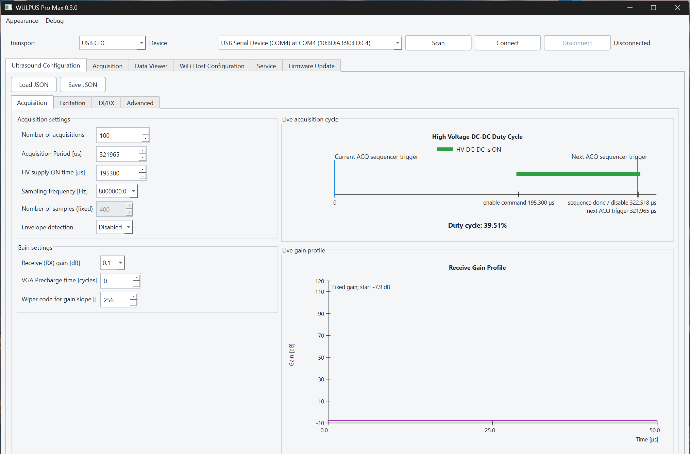
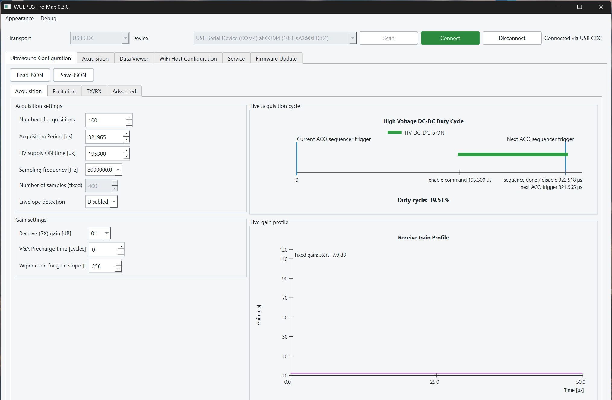
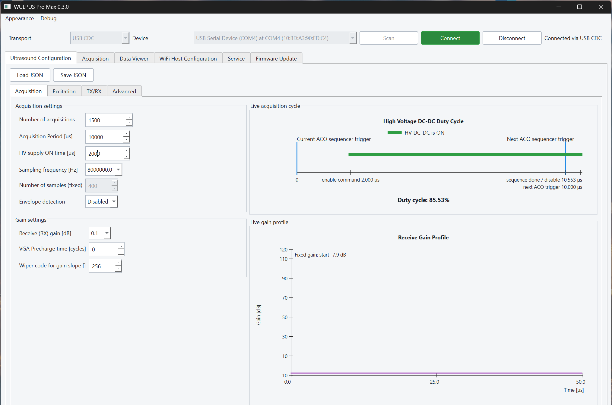
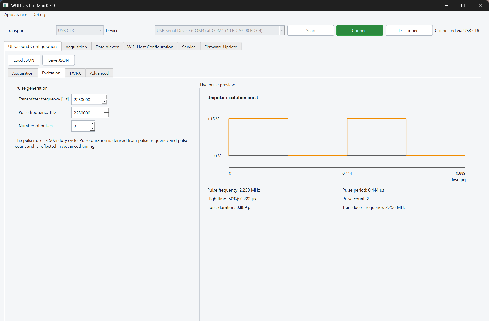
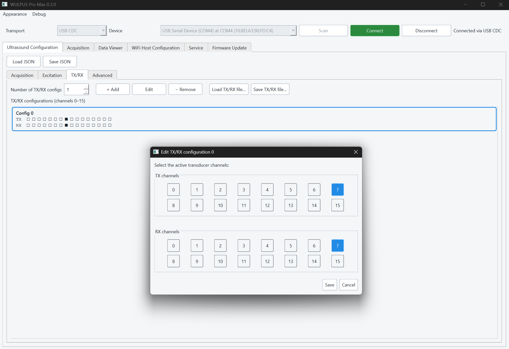
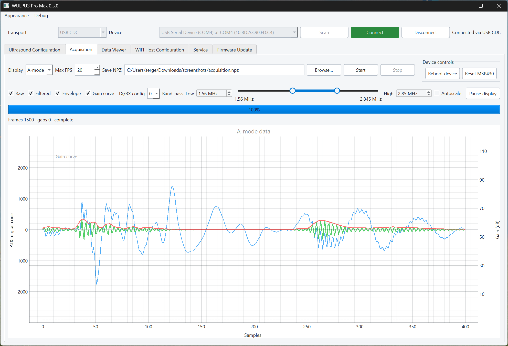
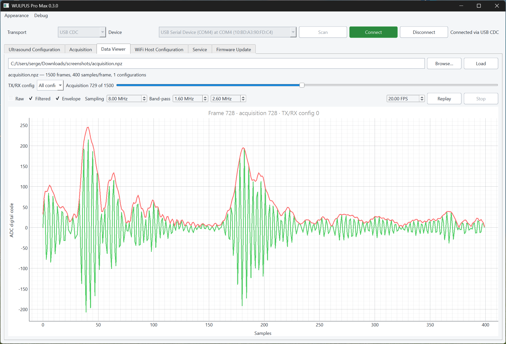
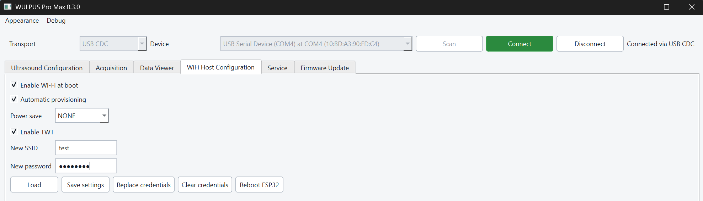
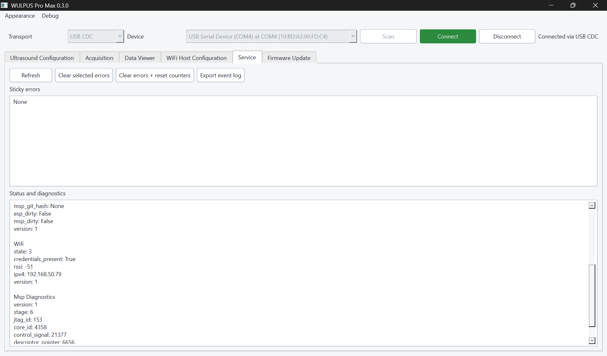

# Desktop Application

The WULPUS Pro Max desktop application provides the normal workflow for device
configuration, acquisition, saved-data inspection, diagnostics, and firmware
updates.

[TOC]

## Start the application

Download the latest compiled application from
[GitHub Releases](https://github.com/Sergio5714/wulpus-pro-max/releases).

On Windows, start the versioned one-file release directly, for example
`WULPUS-Pro-Max-x.x.x.exe`, where `x.x.x` is the release version.
On Ubuntu x86-64, make `WULPUS-Pro-Max-x.x.x-ubuntu-amd64` executable and run
it directly:

```bash
chmod +x WULPUS-Pro-Max-x.x.x-ubuntu-amd64
./WULPUS-Pro-Max-x.x.x-ubuntu-amd64
```

To run the application from source instead, install the desktop dependencies
as described in the
[dependency installation guide](https://github.com/Sergio5714/wulpus-pro-max/blob/dev/sw/docs/dependency_installation.md), then
run from the `sw` folder:

```powershell
uv run --locked --group desktop --group flash python -m desktop_gui.main
```

## Connect a device

In the connection panel at the top of the window, select a transport, select
**Scan** to refresh the available devices, select a device, and then select
**Connect**:

{ .wp-figure width="80%" }

<p align="center"><em>Select a transport, scan for devices, and select the device before connecting.</em></p>

- **USB CDC** provides direct communication through the ESP32-C6 USB
  Serial/JTAG interface. Close serial monitors and other applications using the
  same COM port before connecting.
- **Wi-Fi** discovers devices through mDNS. The computer and device must be on
  the same network. The software also tries the `wulpus_pro.local` hostname if
  multicast discovery is unavailable.
- **BLE** uses the legacy WULPUS USB dongle.

Only one host and one application can control a device at a time. Disconnect
before opening the port in another program or beginning an ESP32 update.

{ .wp-figure width="80%" }

<p align="center"><em>The connection status appears to the right of the connection controls.</em></p>

## Configure ultrasound acquisition

The **Ultrasound Configuration** tab contains four configuration panels.

**Acquisition:** Set the number and period of acquisitions, high-voltage supply
ON time, envelope detection, and receive gain. The live previews show the
high-voltage duty cycle and receive-gain profile.

{ .wp-figure width="80%" }

<p align="center"><em>Acquisition timing, receive gain, and live previews.</em></p>

**Excitation:** Set the excitation frequency and pulse count. The live pulse
preview shows the resulting excitation waveform and timing.

{ .wp-figure width="80%" }

<p align="center"><em>Excitation settings and live pulse preview.</em></p>

**TX/RX:** Add, edit, remove, load, or save TX/RX configurations. When editing
a configuration, select its active transmit and receive channels.

{ .wp-figure width="80%" }

<p align="center"><em>TX/RX configurations and active channel selection.</em></p>

**Advanced:** Configure the ADC, PGA, pulser, HV-MUX, and capture timing. The
detailed acquisition-sequence preview shows the resulting timing.

Resolve timing errors shown by the live previews before starting acquisition.
Save reusable ultrasound and TX/RX configurations as JSON files.

## Acquire and save data

Choose A-mode, B-mode, or **Off** in the display selector. Turning display off
keeps acquisition and optional NPZ recording active while avoiding plot
processing, which provides the highest throughput.

Set the acquisition length and output file as needed, then start acquisition.
The application records raw frames and reports acquisition-number gaps. Stop is
cooperative and may wait for the current receive operation and device cleanup
to finish.

Saved NPZ files contain `data_arr`, `acq_num_arr`, and `tx_rx_id_arr`. Display
filters and envelope processing do not modify the saved raw samples.

{ .wp-figure width="80%" }

<p align="center"><em>The Acquisition tab contains recording, display, filtering, progress, and device controls.</em></p>

## Inspect saved data

Open the **Data Viewer** tab and select a compatible NPZ file. The viewer can:

- filter frames by TX/RX configuration;
- move through acquisitions or replay them;
- display raw, band-pass-filtered, and envelope traces;
- switch between A-mode and B-mode views.

{ .wp-figure width="80%" }

<p align="center"><em>The Data Viewer provides file loading, frame selection, replay, and display controls.</em></p>

Legacy NPZ files do not store their sampling frequency. Enter the frequency
used during acquisition before applying filters or interpreting the time axis.

## Device configuration and diagnostics

### Configure the Wi-Fi host

Connect over USB CDC to manage persistent ESP32 settings and Wi-Fi credentials.
Reboot the ESP32 after changing persistent settings or Wi-Fi credentials. See
[Wi-Fi setup](wifi_setup.md) for configuration, connection, and troubleshooting
instructions.

{ .wp-figure width="80%" }

<p align="center"><em>Wi-Fi settings and credentials are managed in the WiFi Host Configuration tab.</em></p>

### Review service status and diagnostics

Open **Service** and click **Refresh** to inspect:

- sticky error flags;
- frame counters, discarded frames, and buffer occupancy;
- ESP32 and MSP430 firmware information;
- Wi-Fi state, signal strength, and IP address; and
- MSP430 update diagnostics.

{ .wp-figure width="80%" }

<p align="center"><em>The Service tab collects runtime status, firmware information, Wi-Fi status, and diagnostics.</em></p>

!!! info
    The MSP430 firmware version is reported after the first acquisition
    completes. Until then, the GUI displays its version as `unknown`.

Use **Clear selected errors** to clear selected sticky flags, or **Clear errors
+ reset counters** to clear all flags and restart the diagnostic counters.

### Enable debug logging

Enable detailed logging through **Debug > Enable debug logging...**. Logs are
written in batches to reduce acquisition overhead and never include stored
Wi-Fi credentials or firmware payloads.

## Troubleshooting

### The USB device does not appear { .wp-troubleshooting-title }

- Close serial monitors and other programs that may own the COM port.
- Reconnect the data-capable USB cable.
- Select **USB CDC** and click **Scan** again.

### The Wi-Fi device does not appear { .wp-troubleshooting-title }

Follow the [Wi-Fi setup and troubleshooting guide](wifi_setup.md#troubleshooting)
to check connection status, network association, and mDNS discovery.

### Acquisition stalls { .wp-troubleshooting-title }

- Stop the active session.
- Open **Service**, click **Refresh**, and review errors and frame counters.
- If **SPI timeout** appears under **Sticky errors**, open **Acquisition**, click
  **Reset MSP430**, and restart the acquisition.
- If acquisition remains stalled, reboot the ESP32, reconnect the probe, and
  retry.
- If acquisition starts but stalls again, check the recommended PRF and
  visualization settings in [Operating modes](operating_modes.md).
- If the problem persists, enable debug logging, reproduce the issue, and
  review the log.

### The application does not reconnect after a reset or update { .wp-troubleshooting-title }

- Wait for the device to finish booting, select the required transport, and
  click **Scan** to refresh the connection list.
- If the device still does not appear, power-cycle the probe, wait for startup
  to complete, and scan again.

### A firmware update fails { .wp-troubleshooting-title }

Follow the recovery steps in the
[firmware update guide](firmware_update_guide.md).
