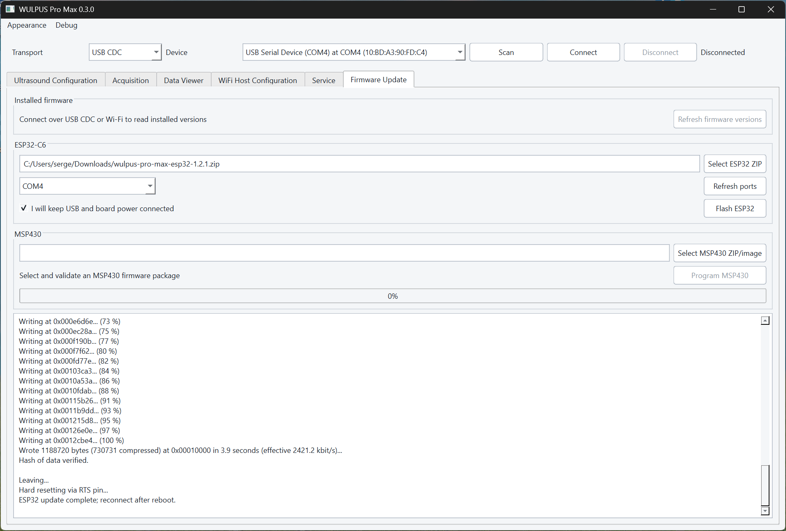
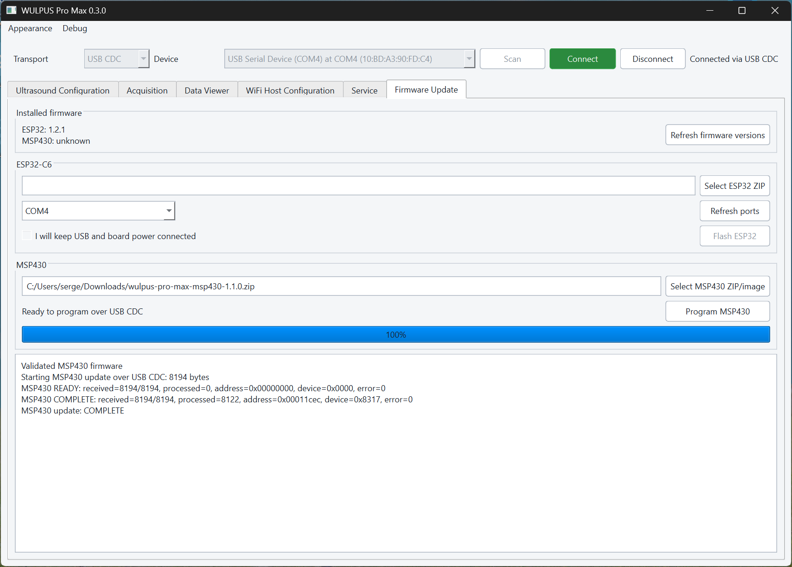

# Firmware update guide

This guide explains how to update the ESP32-C6 and MSP430FR5043 firmware on a
WULPUS Pro Max system using the desktop application. It applies to the default
configuration, with the WiFi host PCB connected to the Acquisition PCB.

Download the ZIP files attached to the corresponding entry on
[GitHub Releases](https://github.com/Sergio5714/wulpus-pro-max/releases). Do not
extract or rename them:

- `wulpus-pro-max-esp32-<version>.zip` updates the ESP32.
- `wulpus-pro-max-msp430-<version>.zip` updates the MSP430.

## Table of contents

- **Preparation**
    - [Before you begin](#before-you-begin)
- **Desktop application workflow**
    - [Update the ESP32](#update-the-esp32-in-the-desktop-application)
    - [Update the MSP430](#update-the-msp430-in-the-desktop-application)
    - [Verify the update](#verify-the-update)
- **Alternative workflow and recovery**
    - [Use the compatibility notebook](#use-the-compatibility-notebook)
    - [Recovery](#recovery)

## Before you begin

You need:

- a WiFi host PCB connected to the Acquisition PCB;
- a data-capable USB-C cable;
- stable power throughout the update; and
- the released ZIP file for the processor you want to update.

Stop any acquisition before updating. Close serial monitors, IDE monitors, and
other applications using the device. If an external MSP-FET is connected,
disconnect it before updating the MSP430.

Keep USB and system power connected until an update finishes.

!!! info "Update order"
    Update the ESP32 before updating the MSP430. The running ESP32 performs the
    MSP430 update through the WiFi host PCB.

!!! info "Hardware requirement"
    Updating the MSP430 requires the WULPUS Pro Max WiFi host PCB. It is not
    available with a standalone XIAO ESP32-C6 connected through the Acquisition
    PCB's Dupont headers.

## Update the ESP32 in the desktop application

Connect the device directly through USB, then follow these steps:

1. Open the **Firmware Update** tab.
2. Select the ESP32 serial port and the released ESP32 ZIP file.
3. Confirm that the application recognizes the package and shows the expected
   version.
4. Select **I will keep USB and board power connected**.
5. Select **Flash ESP32**.
6. Wait for writing and verification to finish and for the ESP32 to restart.
7. Refresh the device list and reconnect.

{ .wp-figure width="80%" }

<p align="center"><em>The ESP32-C6 section contains the firmware package, serial port, power confirmation, update button, and progress log.</em></p>

The normal update preserves the device configuration and saved Wi-Fi
credentials.

If the update cannot start automatically, hold **BOOT**, press and release
**RESET**, release **BOOT**, and try again. Make sure no other application is
using the serial port.

On a freshly fabricated board, update the ESP32 before attempting to update the
MSP430. No external programmer is required for normal initial programming with
the WiFi host PCB.

## Update the MSP430 in the desktop application

If both processors need updating, update the ESP32 first.

1. Connect to the ESP32 host through USB or Wi-Fi.
2. Open the **Firmware Update** tab and select the released MSP430 ZIP file.
3. Select **Program MSP430**.
4. Wait while the application uploads the firmware and the ESP32 programs and
   verifies the MSP430.
5. Confirm that the application reports `COMPLETE` and refreshes the installed
   firmware versions.

{ .wp-figure width="80%" }

<p align="center"><em>A successful MSP430 update reaches 100% and reports <code>COMPLETE</code> in the log.</em></p>

`COMPLETE` means that programming and verification succeeded. Perform a basic
acquisition afterward to confirm that the complete system works normally.

The application displays the MSP430 firmware version as `unknown` until the
first acquisition completes. It then displays the detected version
automatically.

## Verify the update

Confirm that the displayed ESP32 and MSP430 versions match the selected release
packages. The MSP430 version appears after the first successful acquisition.
Perform a basic acquisition to confirm normal operation.

## Use the compatibility notebook

This is an alternative to the desktop application. From the `sw` directory,
start Jupyter and open `wulpus_pro_firmware_update.ipynb`:

```powershell
uv sync --group flash
uv run --group flash jupyter notebook
```

The notebook has separate ESP32 and MSP430 sections.

For an ESP32 update:

1. Refresh the port list and select the ESP32-C6 port.
2. Select the released ESP32 ZIP file.
3. Confirm that USB and power will remain connected, then select
   **Flash ESP32**.
4. Wait for writing, verification, restart, and USB reconnection to finish.

For an MSP430 update:

1. Wait for the ESP32 to restart, then refresh and open its COM port in the
   MSP430 section.
2. Select the released MSP430 ZIP file and select **Upload and program**.
3. Keep USB and system power connected while the file is uploaded and the
   ESP32 restarts to program and verify the MSP430.
4. Reconnect and select **Check status** if the result does not return
   automatically. Confirm that the result is `COMPLETE` with error zero.

## Recovery

An interrupted MSP430 update does not resume automatically, and the MSP430 has
no automatic rollback. Reconnect and retry the complete update. If the ESP32
cannot identify or program the MSP430, recovery may require an external
programmer.

Developers investigating the updater implementation should use the
[ESP32 MSP430 updater implementation guide](https://github.com/Sergio5714/wulpus-pro-max/blob/dev/fw/esp32/docs/msp430_update_guide.md).
