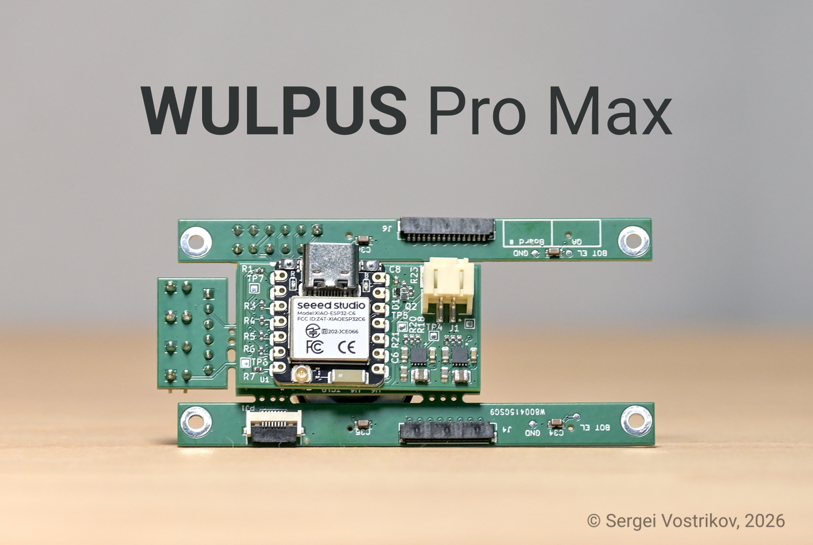

# WULPUS Pro Max

**Multi-mode ultra-low-power wearable ultrasound platform**

WULPUS Pro Max is an open-source platform for ultrasound research and
development—from transducer excitation and acquisition to wireless streaming,
visualization, and analysis.

{ .wp-hero width="80%" }

## Version information

  <strong>Platform</strong> {{ platform_version }}
  <strong>Documentation</strong> {{ documentation_version }}

The platform and documentation have separate release histories. Individual
software and firmware components are versioned independently; see the
[project changelog](CHANGELOG.md) and the component changelogs in the
[source repository](https://github.com/Sergio5714/wulpus-pro-max).

## Get started

  <a class="wp-card" href="hardware_overview.html">
    <strong>Replicate the Hardware</strong>
    Review required components, ordering options, and estimated cost.
  </a>
  <a class="wp-card" href="firmware_update_guide.html">
    <strong>Update Firmware</strong>
    Safely update and verify both system controllers.
  </a>
  <a class="wp-card" href="operating_modes.html">
    <strong>Choose operating mode</strong>
    Set up USB benchtop or portable wireless operation.
  </a>
  <a class="wp-card" href="desktop_gui_usage.html">
    <strong>First acquisition</strong>
    Configure acquisitions, record signals, and review saved data.
  </a>

## Technical reference

The [full specifications](full_specifications.md) summarize the transmit,
receive, acquisition, power, imaging, and mechanical characteristics. Source
code, design files, and developer documentation are available in the
[GitHub repository](https://github.com/Sergio5714/wulpus-pro-max).

### System diagram

{ .wp-figure width="80%" }

<em>WULPUS Pro Max system diagram.</em>

