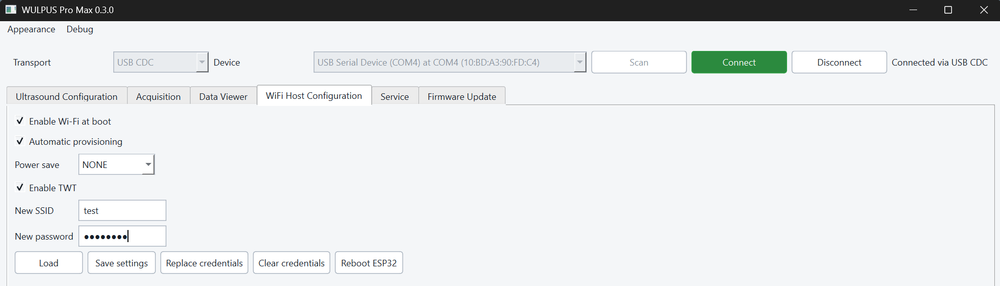

# Operating modes

This guide explains how to power and operate the default WULPUS Pro Max system
over USB or Wi-Fi and how to choose pulse repetition frequency.

## Table of contents

- [Benchtop operation: Power supply and data streaming over USB](#benchtop-operation-power-supply-and-data-streaming-over-usb)
    - [Set up USB operation](#set-up-usb-operation)
    - [Choose a benchtop PRF](#choose-a-benchtop-prf)
- [Wireless operation: Portable power supply and data streaming over Wi-Fi](#wireless-operation-portable-power-supply-and-data-streaming-over-wi-fi)
    - [Configure Wi-Fi over USB](#configure-wi-fi-over-usb)
    - [Choose a wireless PRF](#choose-a-wireless-prf)

!!! info "PRF terminology"
    - The rates below are pulse repetition frequencies (PRFs). One acquisition
      is performed per configured acquisition period, so a 300 Hz PRF produces
      300 acquisitions per second (300 FPS).
    - PRF does not describe the GUI plot refresh rate. The maximum supported
      PRF is 500 Hz.
    - Actual streaming stability also depends on the PC, USB power, Wi-Fi
      network, and GUI visualization load.

## Benchtop operation: Power supply and data streaming over USB

### Set up USB operation

1. Connect the WiFi host PCB to the Acquisition PCB, then connect the host PCB
   to the PC with a data-capable USB-C cable. USB supplies power and carries
   data over USB CDC; no battery is required.
2. For best performance, use a stable USB power source. If using a laptop,
   connect its charger to a wall outlet. As a lab testing recommendation for
   demanding acquisitions on Windows, run the desktop GUI as administrator.
3. In the GUI, select **USB CDC** and connect to the probe. In **WiFi Host
   Configuration**, clear **Enable Wi-Fi at boot**, click **Save settings**, and
   click **Reboot ESP32**. Reconnect over USB after the reboot. Disabling Wi-Fi
   avoids running the power-consuming radio during a USB-only session.
4. Configure acquisition in **Ultrasound Configuration** and start it from the
   **Acquisition** tab. In the display selector, choose **A-mode**, **B-mode**,
   or **Off**. **Off** disables live plotting while acquisition and optional
   recording continue.

### Choose a benchtop PRF

| PRF / acquisition rate | Recommended GUI display mode | Recommended use |
|---|---|---|
| Up to about 100 Hz | A-mode or B-mode | Least demanding range; typically stable without special tuning. |
| Above 100 Hz to about 300 Hz | A-mode or B-mode | Live visualization is practical on a PC with capable hardware and no other demanding applications running. Continuous operation around 300 Hz is supported. |
| Above 300 Hz and below 500 Hz | **Off** | Disable live plotting to reduce GUI processing. Check discarded-frame and acquisition-gap indicators. |
| 500 Hz | **Off** | Maximum rate, at the edge of the hardware's capabilities; use short bursts only. Check discarded-frame and acquisition-gap indicators after each run. |

## Wireless operation: Portable power supply and data streaming over Wi-Fi

Wireless operation sends data over Wi-Fi. Supply power in one of two ways:

| Power source | Connection | Startup |
|---|---|---|
| USB power bank | Plug its USB-C output into the WiFi host PCB. | The board starts from USB power; the cable carries power, while data uses Wi-Fi. |
| Single-cell Li-Po battery | Use the host PCB's JST battery connector. Choose a battery rated to supply at least 1 A peak discharge current. | After **each** battery reconnection, briefly connect USB-C power to wake the onboard battery protector. Then remove USB-C power for cable-free operation. |

Use a battery with the correct connector polarity. The Li-Po battery can be
charged through USB-C. The XIAO ESP32-C6's charging circuit is configured for
approximately **120 mA nominal charge current**, according to the
[Seeed XIAO ESP32-C6 schematic](https://files.seeedstudio.com/wiki/SeeedStudio-XIAO-ESP32C6/XIAO-ESP32-C6_v1.0_SCH_PDF_24028.pdf).

!!! info "Technical note"
    After the battery is first connected, the BQ29700 protector may keep the
    board unpowered until USB power is briefly applied. See the
    [BQ29700 datasheet](https://www.ti.com/lit/ds/symlink/bq2970.pdf) for the
    first-connection behavior.

### Configure Wi-Fi over USB

1. Connect the probe to the PC with a data-capable USB-C cable. In the GUI,
   select **USB CDC** and connect.
2. Open **WiFi Host Configuration**. Select **Enable Wi-Fi at boot** and click
   **Save settings**.
3. Enter **New SSID** and **New password**, then click **Replace credentials**.
   The GUI can report whether credentials are present, but cannot read back the
   saved SSID or password.
4. For high acquisition rates, set **Power save** to **NONE** and click
   **Save settings** again. Click **Reboot ESP32** so the settings and
   credentials take effect.
5. After reboot, the probe joins the configured network. Disconnect the USB
   session, select **Wi-Fi** in the GUI, scan for the probe, and connect. The PC
   and probe must be on a network that permits device discovery and TCP
   communication. A USB cable may remain connected for power; it does not
   prevent a Wi-Fi session once the USB session is closed.

{ .wp-figure width="80%" }

<em>Configure Wi-Fi startup, credentials, provisioning, and power saving before rebooting the ESP32.</em>

To change networks, reconnect over USB and use **Replace credentials**. To
remove saved credentials, use **Clear credentials** in **WiFi Host
Configuration** and reboot. To use the automatic ESP-IDF SoftAP setup instead,
also select **Automatic provisioning** and **Enable Wi-Fi at boot**, save the
settings, then reboot. Follow the
[Wi-Fi provisioning guide](https://github.com/Sergio5714/wulpus-pro-max/blob/dev/fw/esp32/docs/wifi_provisioning_guide.md) for the
provisioning client and security settings. Saved credentials take priority over
automatic provisioning until they are cleared.

### Choose a wireless PRF

| PRF / acquisition rate | Recommended Wi-Fi setting and use |
|---|---|
| Below 100 Hz | Maximum power saving is suitable when battery life is the priority. |
| Around 100–300 Hz | Reduce power saving if streaming becomes unstable. PC and network quality matter more at these rates. |
| Around 300–400 Hz | Set **Power save** to **NONE** for stable continuous streaming on a strong Wi-Fi connection and a PC with capable hardware and no other demanding applications running. Reduce GUI visualization load if needed. |
| Up to 500 Hz | Set **Power save** to **NONE**, select **Off** in the GUI display selector to disable live visualization, and use short bursts only. This is the maximum PRF and leaves little performance margin. |

These are operating recommendations, not guaranteed throughput on every
network. At high rates, keep the PC and probe on a strong Wi-Fi connection,
choose **Off** in the GUI display selector if plotting limits throughput, and
check for acquisition-number gaps or discarded frames after each run. See the
[desktop GUI usage guide](desktop_gui_usage.md) for connection,
recording, and diagnostic controls.
