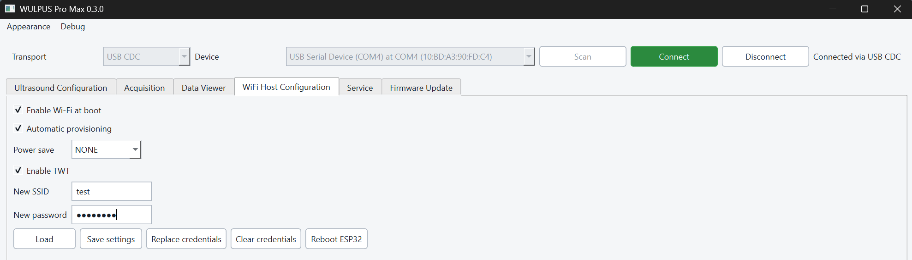
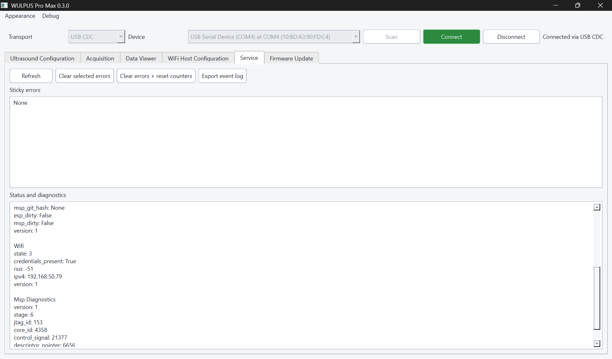

# Wi-Fi setup

This guide explains how to connect WULPUS Pro Max to a Wi-Fi network, replace
or remove saved credentials, and troubleshoot discovery.

[TOC]

## Prerequisites

Before you begin, prepare the following:

- the WULPUS Pro Max desktop application;
- a data-capable USB-C cable;
- a 2.4 GHz Wi-Fi network that both the PC and WULPUS Pro Max can reach; and
- the Wi-Fi network name (SSID) and password.

## Configure a Wi-Fi network over USB

1. Connect the probe to the PC with a data-capable USB-C cable.
2. In the desktop application, select **USB CDC**, scan for devices, select the
   probe, and click **Connect**.
3. Open **WiFi Host Configuration** and click **Load**.
4. Select **Enable Wi-Fi at boot**. Select **Automatic provisioning** only if
   you want the fallback SoftAP workflow described below.
5. Enter the network name under **New SSID** and its password under
   **New password**, then click **Replace credentials**.
6. Choose the required **Power save** setting and click **Save settings**.
   Select **NONE** for the most reliable high-rate streaming.
7. Click **Reboot ESP32** and confirm the reboot.

The USB session closes during reboot. Allow time for the probe to start,
associate with the access point, obtain an IP address, and advertise its mDNS
service before scanning for it over Wi-Fi.

{ .wp-figure width="80%" }

<p align="center"><em>Wi-Fi startup policy and credentials are configured over USB CDC.</em></p>

!!! note "Credential storage and validation"
    The ESP32 stores credentials in non-volatile memory. The desktop application
    can report whether credentials are present, but it cannot read back the saved
    SSID or password.

    A successful **Replace credentials** operation confirms that the values were
    accepted and stored. It does not confirm that the SSID exists, that the
    password is correct, or that the probe obtained an IP address.

## Connect over Wi-Fi

1. Ensure the PC is connected to the same network as the probe.
2. Close or disconnect the USB CDC session. The cable may remain attached for
   power.
3. Select **Wi-Fi** in the desktop application's connection panel.
4. Click **Scan**. When the probe appears, select it and click **Connect**.

!!! note
    The application discovers the probe through mDNS and also tries the
    `wulpus_pro.local` hostname. The network must permit communication between
    wireless clients and TCP traffic to the probe on port 2121.

!!! warning
    Only one protocol session can control the probe at a time. A connected USB
    session can therefore prevent a Wi-Fi session even when both transports are
    available.

## Change or remove credentials

To move the probe to another network:

1. Connect over USB CDC.
2. Enter the new SSID and password and click **Replace credentials**.
3. Reboot the ESP32, then connect the PC to the target network and scan again.

To remove the saved network:

1. Connect over USB CDC.
2. Click **Clear credentials** and confirm the removal.
3. Reboot the ESP32.

!!! info
    If **Automatic provisioning** and **Enable Wi-Fi at boot** are both selected,
    the probe starts its provisioning SoftAP after reboot. Otherwise, it remains
    available over USB only.

## Automatic provisioning

Automatic provisioning is an alternative to entering credentials through the
desktop application. Install Espressif's
[ESP SoftAP Provisioning application for Android](https://play.google.com/store/apps/details?id=com.espressif.provsoftap)
or [iOS](https://apps.apple.com/app/esp-softap-provisioning/id1474040630).
Provisioning on WULPUS Pro Max starts only when all of the following are true:

- **Enable Wi-Fi at boot** is selected;
- **Automatic provisioning** is selected; and
- no credentials are stored.

The probe creates a temporary `PROV_WULPUS_PRO_XXXXXX` SoftAP and accepts
credentials from an ESP-IDF-compatible provisioning client. Saved credentials
always take priority, so clear them before attempting to start the SoftAP.

!!! info
    For provisioning security, proof-of-possession settings, and the firmware boot
    state machine, see the
    [firmware Wi-Fi provisioning guide](https://github.com/Sergio5714/wulpus-pro-max/blob/dev/fw/esp32/docs/wifi_provisioning_guide.md).

## Troubleshooting

### Check Wi-Fi status

Connect through USB CDC. In **WiFi Host Configuration**, click **Load** to
check whether credentials are stored.

For detailed status, open **Service** and click **Refresh**. Status is available
over USB CDC or Wi-Fi; use USB CDC when the wireless connection is unavailable.
The Wi-Fi section shows the following relevant fields:

{ .wp-figure width="80%" }

<p align="center"><em>The Service tab reports detailed Wi-Fi status under Status and diagnostics.</em></p>

| Field | Meaning |
|---|---|
| `state` | Current Wi-Fi state, decoded in the table below. |
| `credentials_present` | `True` when credentials are stored. This does not confirm that they are valid. |
| `rssi` | Received signal strength in dBm while connected. Values closer to 0 indicate a stronger signal. |
| `ipv4` | Address assigned to the probe. `0.0.0.0` means that no address is currently available. |

| `state` | Wi-Fi state |
|---|---|
| `0` | Disabled |
| `1` | Provisioning |
| `2` | Connecting |
| `3` | Connected |
| `4` | Disconnected |

!!! info
    State `3` with a non-zero `ipv4` address indicates that the probe joined
    the network and completed DHCP.

After checking the Wi-Fi status, compare the observed state with
the common issues below.

### The probe does not join the configured network { .wp-troubleshooting-title }

This section applies when `state` is `2` (connecting) or `4` (disconnected),
or when `ipv4` remains `0.0.0.0`.

- Confirm that **Enable Wi-Fi at boot** is selected.
- Re-enter the SSID and password. **Credentials present** confirms only that
  values are stored; it does not confirm that they are correct.
- Confirm that the access point provides a 2.4 GHz network and that the probe
  is within range.
- Save the settings, reboot the ESP32, and allow time for association and DHCP.
- Check the access point for authentication or association failures if the
  probe still does not obtain an address.

### The probe is connected but does not appear in a Wi-Fi scan { .wp-troubleshooting-title }

If `state` is `3` and `ipv4` contains a valid address, the probe has joined the
network and the remaining problem is mDNS discovery or network reachability.

- Confirm that the PC is on the same reachable network as the probe.
- Click **Scan** again after allowing time for mDNS advertisement.
- Ensure that the access point does not isolate wireless clients.
- Allow mDNS on UDP port 5353 and device TCP traffic on port 2121 through the
  PC firewall and network.

### The provisioning SoftAP does not appear { .wp-troubleshooting-title }

State `1` indicates that the provisioning workflow is active.

- Confirm that **Enable Wi-Fi at boot** and **Automatic provisioning** are both
  selected.
- Clear any stored credentials; saved credentials take priority over automatic
  provisioning.
- Reboot the ESP32 and scan for `PROV_WULPUS_PRO_XXXXXX` again.

### The application reports that the device is busy { .wp-troubleshooting-title }

When another USB or Wi-Fi client already controls the probe, the desktop
application shows an **Operation failed** dialog containing:

```text
WULPUS Pro Max is busy or controlled through another transport
```

Disconnect the active client and retry. A USB cable used only for power can
remain connected; the physical cable alone does not claim the session.

